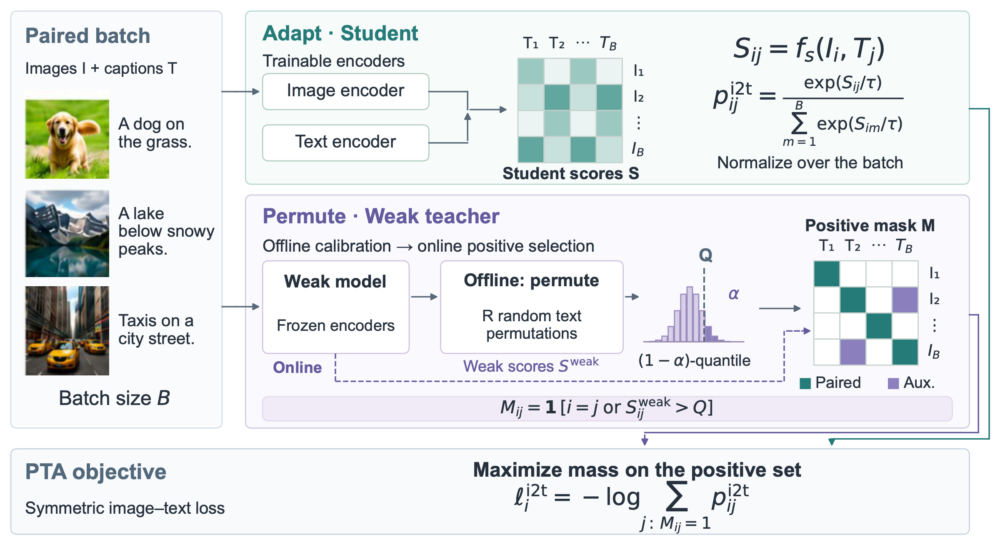

<div align="center">


<h1>Permute-then-Adapt <sub>PTA</sub></h1>

<p><strong>Weak-to-Strong Contrastive Image–Text Adaptation</strong></p>

<p>Jinhao Li · Sarah Erfani · Lei Feng · Guangrui Li · James Bailey · Feng Liu</p>

<p>
  <a href="https://openreview.net/forum?id=ibeDXGKMar"></a>
  <a href="https://openreview.net/forum?id=ibeDXGKMar"></a>
  <a href="LICENSE"></a>
</p>

<p><strong>🔀 Permute</strong> &nbsp; → &nbsp; <strong>🎯 Calibrate</strong> &nbsp; → &nbsp; <strong>🚀 Adapt</strong></p>

<p>
  <a href="#installation">⚡ Quickstart</a> &nbsp;·&nbsp;
  <a href="src/pta">📦 Code</a> &nbsp;·&nbsp;
  <a href="data/README.md">🗂️ Data</a> &nbsp;·&nbsp;
  <a href="#citation">📝 Citation</a>
</p>

</div>

---

PTA uses a frozen image–text teacher to select auxiliary positive pairs for
adapting a stronger student. It estimates a reference from randomly permuted
captions, calibrates a threshold, and trains the student to assign probability
mass to each observed match together with its selected in-batch positives.

<p align="center">
  <a href="assets/pta-overview.png">
    
  </a>
</p>

<p align="center">
  <sub><strong>PTA overview.</strong> Permutation calibration with a frozen weak teacher, followed by positive-set student adaptation.</sub>
</p>

This repository contains the PTA objective, permutation calibration, training,
evaluation, and data-acquisition instructions.

## Installation

Use Python 3.11 and a CUDA-capable GPU for the COCO training recipe. The pinned
direct dependencies are in `pyproject.toml`. Install a PyTorch build compatible
with your GPU driver, then install this package:

```bash
git clone https://github.com/JinhaoLee/Permute-then-Adapt.git
cd Permute-then-Adapt
python -m pip install -e '.[eval]'
```

The code supports CPU/FP32 for small checks. The paper-style configuration uses
BF16 model weights. CUDA, GPU, package versions, and resolved settings are saved
with each training run.

## Data

The example recipe uses **COCO Captions 2014**. Follow [data/README.md](data/README.md)
to obtain the official train/validation images and annotations:

```bash
python scripts/download_coco.py --list-only
python scripts/download_coco.py --root data/coco --extract
```

For another dataset, supply image-disjoint training and validation JSONL files
with one image and its captions per row. The data guide describes the schema,
path resolution, and how to obtain data from its original provider. Images and
pretrained weights are acquired separately; asset sources and terms are in
[THIRD_PARTY_NOTICES.md](THIRD_PARTY_NOTICES.md).

## Train PTA

```bash
python -m pta.train --config configs/coco.json --seed 41 \
  --output-dir runs/pta-coco-seed41
```

The configuration uses a CLIP ViT-B/32 teacher and ViT-B/16 student, batch size
512, learning rate `1.25e-5`, cosine scheduling, and validation-based early stopping
within a maximum of 20 epochs. It trains all vision transformer blocks and the
visual projection, the last two text transformer blocks and the text projection,
and the student logit scale. The vision embeddings and surrounding layer norms
remain frozen, matching the recorded training configuration.

The public loss is the symmetric positive-set marginal likelihood from the
paper. The diagonal is always positive; auxiliary pairs use the strict comparison
`teacher_score > Q`. The implementation uses log-sum-exp reductions for numerical
stability. There is no additional loss-mixing parameter.

The default calibration recipe retains **5,000 permuted scores**, using one
uniform caption permutation per calibration batch of 1,000 records. Fixed-point
positions are discarded without repairing the permutation; repeated scores keep
their weight. A further batch is read when filtering leaves the score budget
unfilled. The finite-rank cutoff is the `ceil((M+1)*(1-alpha))`-th order statistic;
an unavailable rank gives an infinite cutoff. This is a reference-calibration
procedure, not a guarantee that every selected pair is semantically correct.

`calibration_budget_unit`, `calibration_device`, `calibration_rule`, and
`validation_caption_mode` are explicit configuration fields. The recorded recipe
uses CPU/BF16 calibration and first-caption validation; validation's checkpoint
selection score averages both directions at recall@1, @5 and @10. Full-caption
retrieval and Karpathy test splits are separate evaluation protocols.

To use your own manifests:

```bash
python -m pta.train --config configs/coco.json \
  --train-manifest data/train-local.jsonl \
  --validation-manifest data/validation-local.jsonl \
  --set coco_root=null --output-dir runs/pta-custom
```

Other fields can be overridden with `--set KEY=VALUE`; JSON values are accepted.
Use a fresh output directory for each run. Outputs include the best and last
checkpoints, calibration scores and threshold, resolved configuration,
environment information, sampling hashes, validation history, and a summary.

## Evaluation

Retrieval records use the same image/captions JSONL schema:

```bash
python -m pta.evaluate --checkpoint runs/pta-coco-seed41/best \
  --task retrieval --records data/retrieval-test-local.jsonl \
  --caption-mode all --numerics fp32 --protocol my-test-split \
  --output runs/pta-coco-seed41/retrieval.json
```

Classification records contain `image` and a zero-based `label`. Supply a JSON
list of class names in the exact corresponding label order:

```bash
python -m pta.evaluate --checkpoint runs/pta-coco-seed41/best \
  --task classification --records data/classification-test-local.jsonl \
  --class-names data/class-names-local.json \
  --output runs/pta-coco-seed41/classification.json
```

A suite manifest can name multiple datasets and their protocols; see
[configs/eval-suite.example.json](configs/eval-suite.example.json). Use
`--task suite --suite PATH` instead of `--records`. The evaluator records caption
policy, prompt template, class count and score units. `--numerics legacy` matches
the original classification/validation precision conventions; `--numerics fp32`
uses FP32-normalized features. Keep that setting fixed when comparing models.

## Citation

```bibtex
@inproceedings{li2026permute,
  title     = {{Permute-then-Adapt}: Weak-to-Strong Contrastive Image--Text Adaptation},
  author    = {Li, Jinhao and Erfani, Sarah and Feng, Lei and Li, Guangrui and Bailey, James and Liu, Feng},
  booktitle = {Advances in Neural Information Processing Systems},
  year      = {2026}
}
```

Contact: [Jinhao Li](mailto:jinhao.li2@unimelb.edu.au).

## License

The PTA implementation is available under the [MIT License](LICENSE). Datasets,
pretrained models, and dependencies retain their own terms; see
[THIRD_PARTY_NOTICES.md](THIRD_PARTY_NOTICES.md).
